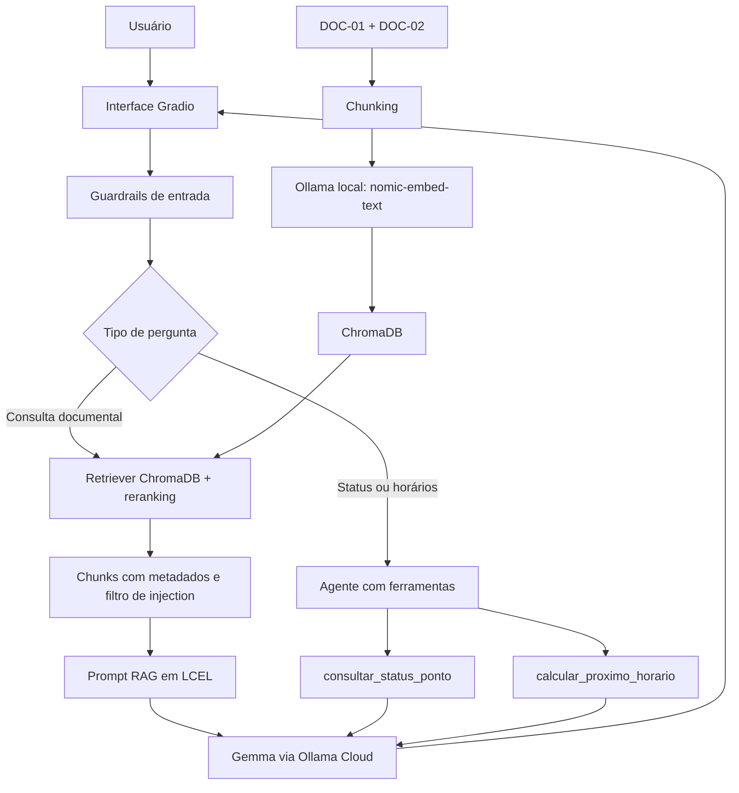

# CitizenTech ColetAr — Global Solution 2026.2

**FIAP — Ciência da Computação | Turma 1CCPI**  
**Disciplina:** Prompt and Artificial Intelligence  
**Professor:** Jorge Luiz Gomes  
**Tema:** CitizenTech — Frente B: Descarte e Sustentabilidade

## Integrantes

| Integrante | RM | Turma |
|---|---|---|
| Rafael Gandolfi Gonçalves | 569036 | 1CCPI |
| Guilherme Miranda | 573107 | 1CCPI |
| Carlos Eduardo | 572949 | 1CCPI |

> **Aviso:** o município de Vila Aurora, o Programa ColetAr, os documentos e os pontos de coleta são fictícios, utilizados exclusivamente para fins acadêmicos. Não representam um serviço público real.

## 1. Objetivo

Desenvolver um assistente de IA generativa que auxilie cidadãos a consultar regras de descarte de óleo de cozinha usado, endereços, horários, limites de entrega e interdições de pontos de coleta. A solução utiliza **RAG** para responder com base em fontes documentais, um **agente com ferramentas** para consultas operacionais e uma **avaliação RAGAS** para medir a qualidade das respostas.

A principal exigência de confiabilidade é reconhecer que **um documento posterior pode substituir informações de um documento anterior**, sem inventar fatos quando a base não responde à pergunta.

## 2. Arquitetura



### Tecnologias

- **Python / Google Colab:** implementação em notebook executável.
- **LangChain e LCEL:** composição do pipeline RAG e integração com modelos e ferramentas.
- **ChromaDB:** índice vetorial dos trechos documentais, com metadados.
- **Ollama local + `nomic-embed-text`:** geração de embeddings.
- **Ollama Cloud + `gemma4:cloud`:** modelo de linguagem para respostas, agente e avaliação.
- **Gradio:** interface de perguntas e respostas, incluindo histórico visual e fontes.
- **RAGAS 0.4.3:** avaliação quantitativa de respostas e contexto recuperado.

## 3. Base documental e contradição deliberada

A base contém **dois documentos originais e fictícios**, com mais de 100 palavras cada, armazenados em `2_base_documental/`:

| Documento | Publicação | Função |
|---|---|---|
| `doc_01_regulamento_coletar.txt` — **DOC-01** | 10/08/2026 | Regulamento inicial: condições de entrega, gratuidade, limite de 5 litros por morador por visita, localização e horário dos pontos. |
| `doc_02_comunicado_atualizacao.txt` — **DOC-02** | 20/10/2026 | Comunicado posterior que atualiza situações operacionais e horários. |

**Armadilha documental:** o DOC-01 contém informações posteriormente desatualizadas. O DOC-02 informa que o ponto **CA-102 está interditado**, que o **CA-101 atende de segunda a sexta, das 9h às 16h**, e que o recebimento no **CA-103 aos sábados se encerra às 14h**, ainda que o estabelecimento possa permanecer aberto por mais tempo. O sistema deve dar precedência às informações operacionais atualizadas, citando o documento correspondente.

As perguntas sobre bairros ou locais não mencionados na base devem resultar em uma resposta de **informação não encontrada**, sem inventar endereços.

## 4. Chunking, embeddings e recuperação

Foram comparadas duas configurações de `RecursiveCharacterTextSplitter`:

| Estratégia | `chunk_size` | `chunk_overlap` | Avaliação técnica |
|---|---:|---:|---|
| A | 500 | 50 | Trechos menores, mais específicos para horários, IDs e mudanças pontuais. |
| B | 1000 | 100 | Trechos maiores preservam contexto, mas podem misturar informações de diferentes regras. |

Foi escolhida a configuração **500/50** para o índice principal, buscando maior precisão em consultas curtas sobre pontos de coleta. A escolha é uma decisão de projeto, não uma prova de superioridade universal: os resultados dependem do corpus e das perguntas.

Os chunks preservam informações como `doc_id`, `titulo`, `data_publicacao` e `tema`. A recuperação combina busca semântica e **reranking lexical**, com atenção a identificadores de pontos, termos da consulta e atualizações documentais. Os trechos recuperados são passados ao modelo com identificação de fonte para permitir a citação na resposta.

## 5. Pipeline RAG com contexto

A cadeia utiliza a composição **retriever → contexto documental → prompt → ChatOllama → parser**, construída com LCEL. O prompt orienta o modelo a usar exclusivamente as evidências fornecidas e a indicar quando não encontra informação suficiente.

**Casos demonstrados no notebook:**

1. **CA-102:** deve responder que o ponto está interditado e atribuir a atualização ao DOC-02.
2. **CA-101:** deve empregar o horário atualizado de segunda a sexta, **9h–16h**.
3. **Bela Vista:** deve reconhecer que a base não fornece um ponto confirmado nesse bairro, em vez de inventar um.

## 6. Agente e ferramentas

O agente pode decidir consultar ferramentas quando a pergunta exige uma informação operacional ou um cálculo:

- **`consultar_status_ponto(id_ponto)`**: retorna a situação de um ponto conhecido, considerando atualizações documentais e IDs inválidos.
- **`calcular_proximo_horario(id_ponto, data_hora)`**: calcula uma próxima janela de atendimento a partir dos dias e horários cadastrados, considerando eventuais interdições e entradas inválidas.

As chamadas geram um **trace** de ações, argumentos e observações, para demonstrar que a ferramenta foi realmente utilizada. O fluxo limita o número de chamadas a **seis por pergunta**, evitando laços indefinidos.

## 7. Interface e segurança

A interface **Gradio** oferece um chat com histórico visual, exemplos de perguntas e respostas com indicação de fontes. O notebook demonstra a interface e a integração do RAG e das ferramentas.

Foram implementados e testados **quatro guardrails**:

1. **Escopo:** tratamento de perguntas fora do tema do Programa ColetAr.
2. **Prompt injection:** filtragem de instruções suspeitas no material documental.
3. **Privacidade / LGPD:** bloqueio de solicitações sensíveis incompatíveis com a finalidade do assistente.
4. **Ausência de evidência:** orientação para não inventar respostas quando os documentos não oferecem suporte.

Esses controles são mecanismos de redução de risco e **não garantem proteção completa** contra todas as formas de ataque ou alucinação.

**Evidência da interface:** [captura do Gradio com resposta sobre o CA-102](https://github.com/RafaelGandolfiG/global-solution-2sem-IA-1CCPI/blob/main/print_interface_gradio.png).

## 8. Como executar no Google Colab

**Notebook compartilhado:** [Abrir no Google Colab](https://colab.research.google.com/drive/1hS2vI2HpK3p0J6B3Yzq-GqjK_4mkrSo9?usp=sharing).

**Repositório:** [GitHub — CitizenTech ColetAr](https://github.com/RafaelGandolfiG/global-solution-2sem-IA-1CCPI).

### Pré-requisitos

- Conta Google com acesso ao Colab e conexão à internet.
- Chave pessoal válida da **Ollama Cloud**, autorizada para o modelo utilizado.
- Permissão para executar comandos de instalação e iniciar o Ollama no runtime do Colab.

### Procedimento

1. Abra a cópia atualizada do notebook no Google Colab.
2. Abra o menu **Secrets** (ícone de chave, na barra lateral).
3. Crie o Secret **`OLLAMA_API_KEY`** e configure o valor da **sua própria chave**, autorizando o acesso do notebook.
4. Em **Ambiente de execução**, inicie uma sessão Python e selecione **Executar tudo (Run all)**.
5. As células iniciais instalam as bibliotecas, instalam/iniciam o Ollama local, baixam `nomic-embed-text`, clonam o repositório para obter `2_base_documental/` e testam a conexão com o modelo remoto.
6. O notebook carrega os documentos, recria o índice ChromaDB, demonstra o RAG, agente, interface, guardrails e executa as oito avaliações RAGAS.
7. Ao término, confira a Seção 7 e o arquivo `3_avaliacao_ragas.json` gerado no ambiente de execução.

**Validação realizada:** a equipe executou **Reiniciar sessão → Executar tudo** no Google Colab e relatou conclusão sem erros em todas as seções. Esse teste confirma o funcionamento no ambiente utilizado, mas versões futuras de bibliotecas, disponibilidade dos serviços ou limites do Colab podem exigir novos ajustes.

**Dependências relevantes:** `ragas==0.4.3` e `langchain-community==0.3.31`. Essas versões foram utilizadas para contornar uma incompatibilidade de importação observada durante os testes.

**Segurança:** nunca coloque a chave diretamente nas células, em capturas, no README, no arquivo `.env.example` ou no GitHub. O arquivo `.env` real não deve ser versionado. Cada avaliador deverá usar a própria chave nos Secrets.

**Persistência:** a pasta `/content` do Colab é temporária. O índice vetorial pode ser recriado a partir dos documentos, mas o JSON gerado pelo teste precisa ser baixado ou copiado ao repositório para persistir.

## 9. Avaliação RAGAS

O conjunto possui **oito perguntas**: quatro simples e quatro relacionadas a atualizações ou contradições dos documentos. As respostas de referência (`ground_truth`) devem ser **revisadas e assumidas pela equipe como elaboração própria**, conforme a regra de autoria da disciplina.

A avaliação utiliza quatro métricas:

- **Faithfulness:** verifica se as afirmações da resposta são sustentadas pelo contexto recuperado.
- **Answer Relevancy:** mede a pertinência da resposta em relação à pergunta.
- **Context Precision:** avalia a relevância e a ordenação dos trechos recuperados.
- **Context Recall:** avalia quanto da informação necessária à resposta de referência está presente no contexto.

### Resultados registrados

| Métrica | Arquivo JSON atualmente publicado no GitHub | Última execução no Colab informada pela equipe |
|---|---:|---:|
| Faithfulness | 1,0000 | 0,9688 |
| Answer Relevancy | 0,8838 | 0,9031 |
| Context Precision | 1,0000 | 1,0000 |
| Context Recall | 0,8750 | 0,8750 |

**Importante:** os resultados da coluna Colab ainda precisam ser exportados para o `3_avaliacao_ragas.json` definitivo no GitHub, para que README, notebook e JSON se refiram à mesma execução. A avaliação não deve ser editada manualmente para aumentar notas.

**Interpretação:** a precisão de contexto elevada indica que os trechos apresentados ao avaliador foram considerados relevantes. O `Context Recall` de 0,8750 aponta ao menos uma limitação detectada no conjunto; a questão sobre o endereço do CA-101 recebeu avaliação desfavorável de recall, apesar de o dado estar disponível na base, situação que exige análise das evidências e do comportamento do juiz RAGAS. O `Faithfulness` inferior a 1,0 na última execução também indica oportunidade de conferir uma resposta sobre a atualização do CA-102.

As métricas descrevem apenas essas **oito perguntas**; não medem a qualidade universal do assistente. A inclusão de reranking é uma melhoria técnica; um eventual ganho quantitativo deve ser demonstrado comparando execuções controladas, e não presumido.

## 10. Decisões e limitações

**Principais decisões:** documentos curtos, fictícios e auditáveis; contradição intencional entre regulamento e comunicado; chunking menor para regras específicas; metadados de proveniência; reranking; ferramentas para cálculos; quatro guardrails; conjunto reproduzível de oito avaliações.

**Limitações:** corpus reduzido e fictício; execução dependente do Ollama local, da Ollama Cloud e da conectividade; heurísticas de reranking; guardrails sem garantia de cobertura completa; avaliação com amostra pequena e variação do LLM juiz; interface com histórico visual que não equivale necessariamente a uma memória conversacional integral. Para uso real seriam necessárias fontes oficiais atualizadas, governança dos dados, testes ampliados, proteção de dados e infraestrutura de produção.

## 11. Evidências e estrutura da entrega

A organização exigida para o **ZIP final** é:

```text
1_Notebook_GS2026_2.ipynb
2_base_documental/
  doc_01_regulamento_coletar.txt
  doc_02_comunicado_atualizacao.txt
3_avaliacao_ragas.json
4_README.md
5_certificacao.txt
6_Chat_Log.txt
7_demo_video_url.txt
```

**Evidências relevantes:** comparação de chunking (Seção 1), recuperação ChromaDB e metadados (Seção 2), três respostas com fontes (Seção 3), trace do agente (Seção 4), captura da interface (Seção 5), testes dos guardrails (Seção 6) e tabela RAGAS (Seção 7). Os resultados e capturas devem ser extraídos de execuções reais.

**Pendências para entrega:** substituir o notebook antigo pelo arquivo corrigido com o nome oficial; sincronizar o JSON da última avaliação; conferir as marcações do `5_certificacao.txt`; gravar o vídeo de até três minutos, com apresentação dos integrantes, e preencher `7_demo_video_url.txt`; reunir o ZIP e enviar no Portal FIAP até **19/11/2026 às 23h59**.

## 12. Uso responsável de inteligência artificial

O ChatGPT foi utilizado como apoio na organização do projeto, explicação das tecnologias, revisão de código, depuração e documentação. A equipe é responsável por verificar as fontes, revisar os `ground_truths`, compreender as escolhas técnicas e validar os resultados. O registro resumido das interações está em `6_Chat_Log.txt`.
