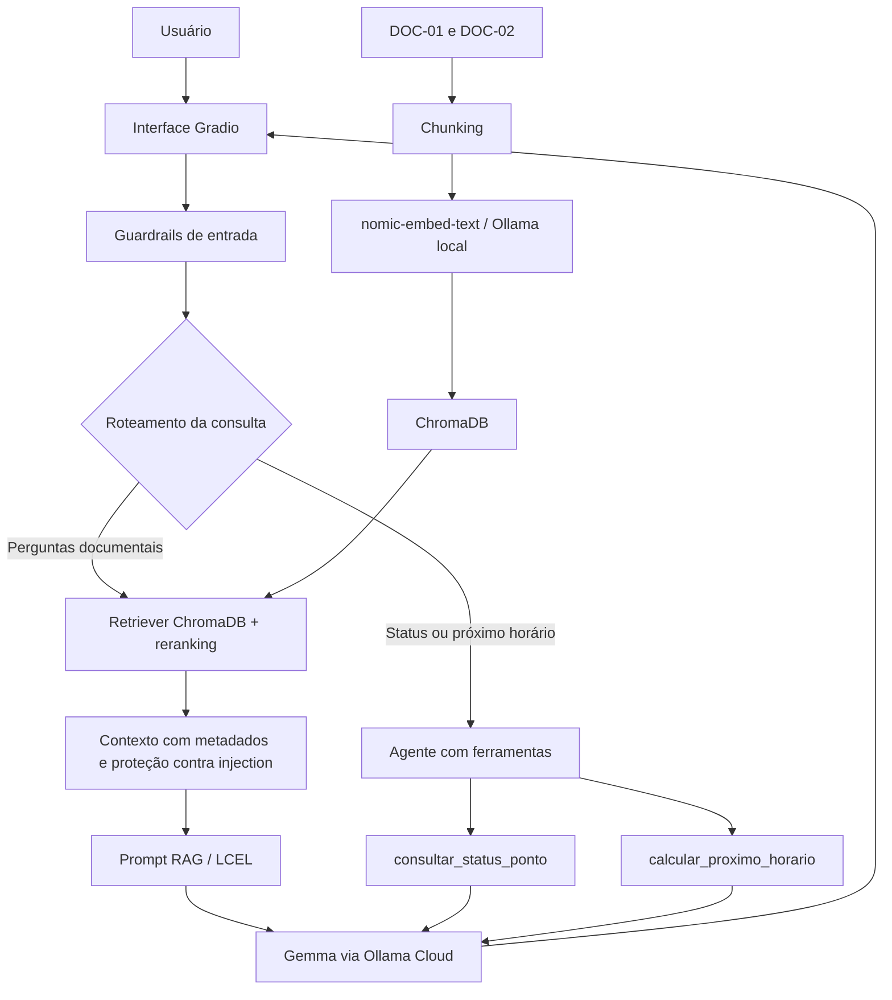

# CitizenTech ColetAr — Global Solution 2026.2

**Curso:** Ciência da Computação — FIAP  
**Turma:** 1CCPI  
**Disciplina:** Prompt and Artificial Intelligence  
**Frente:** B — Descarte e Sustentabilidade  
**Projeto:** CitizenTech ColetAr  
**Integrantes e RMs:** preencher e conferir com a equipe antes da entrega.

> **Aviso:** Vila Aurora, seus documentos e seus pontos de coleta são fictícios, criados para fins acadêmicos. O sistema não representa um serviço público real.

## 1. Objetivo

Desenvolver um assistente de IA generativa para consultas sobre o descarte de óleo de cozinha usado: acondicionamento, limite de entrega, gratuidade, localização dos pontos, horários e interdições. As respostas documentais utilizam RAG e identificam as fontes; um agente consulta o status dos pontos e calcula o próximo horário de atendimento.

## 2. Arquitetura



O histórico de mensagens é exibido na interface; ele ainda não é enviado integralmente ao modelo como memória conversacional.

## 3. Tecnologias

- **Python e Jupyter Notebook:** implementação e execução dos experimentos.
- **LangChain / LCEL:** composição da cadeia RAG e ferramentas do agente.
- **Gemma (`gemma4:cloud`) via Ollama Cloud:** geração de respostas e avaliação como LLM juiz.
- **Ollama local + `nomic-embed-text`:** geração de embeddings em `http://localhost:11434`.
- **ChromaDB:** armazenamento vetorial persistente na pasta `chroma_db`.
- **Gradio:** interface de conversação.
- **RAGAS:** avaliação de Faithfulness, Answer Relevancy, Context Precision e Context Recall.

## 4. Base documental e tratamento de contradições

Os documentos originais estão em `2_base_documental/`:

| Documento | Data | Conteúdo |
|---|---|---|
| `doc_01_regulamento_coletar.txt` (`DOC-01`) | 10/08/2026 | Regras originais de acondicionamento, gratuidade, limite de 5 litros, endereços e horários dos pontos. |
| `doc_02_comunicado_atualizacao.txt` (`DOC-02`) | 20/10/2026 | Atualizações válidas a partir de 21/10/2026: interdição do CA-102; CA-101 até 16h; recebimento de óleo no CA-103 aos sábados até 14h. |

O pipeline compara duas configurações de chunking, **500 caracteres com overlap 50** e **1000 caracteres com overlap 100**, e utiliza a configuração de 500/50 no índice principal. Os chunks preservam metadados como `doc_id`, `titulo`, `data_publicacao` e `tema`.

Quando há incompatibilidade, as informações mais recentes do `DOC-02` prevalecem sobre o `DOC-01`. A recuperação combina similaridade semântica com reranking lexical, correspondência de códigos de pontos e data como critério de desempate.

## 5. Agente e ferramentas

- **`consultar_status_ponto(id_ponto)`:** consulta situação operacional, nome e fonte documental de um ponto; trata IDs inválidos.
- **`calcular_proximo_horario(id_ponto, data_hora)`:** calcula a próxima janela de atendimento, respeitando dias da semana, horários atualizados e interdições; trata entradas inválidas.

O agente registra `ACTION`, argumentos e `OBSERVATION`, e possui limite de **6 chamadas de ferramenta por pergunta**.

## 6. Segurança

Foram implementados quatro guardrails: (1) escopo temático; (2) filtragem de padrões de prompt injection no conteúdo documental; (3) proteção contra pedidos de dados pessoais; e (4) respostas sem invenção quando falta evidência. Foram realizados testes básicos para cada caso. Essas proteções são parciais e não representam garantia completa contra ataques ou pedidos indiretos.

## 7. Execução local (VS Code / Jupyter)

**Pré-requisitos:** Python 3.12 ou ambiente compatível, Jupyter, Ollama instalado e acesso autorizado à Ollama Cloud. Os modelos e dependências podem exigir downloads e conexão à internet.

1. Mantenha o notebook `1_Notebook_GS2026_2.ipynb` e a pasta `2_base_documental/` no mesmo diretório de trabalho.
2. Instale as dependências Python:

   ```bash
   pip install langchain-core langchain-text-splitters langchain-ollama langchain-chroma langchain-community chromadb gradio ragas==0.4.3 python-dotenv pandas jupyter
   ```

3. Inicie o Ollama local e baixe o modelo de embeddings:

   ```bash
   ollama pull nomic-embed-text
   ```

   Confirme que o Ollama responde em `http://localhost:11434` antes de executar o notebook.
4. Crie um arquivo `.env` local, **não incluído no ZIP**, com a variável:

   ```dotenv
   OLLAMA_API_KEY=SUA_CHAVE_PRIVADA
   ```

5. Abra o notebook, selecione o ambiente Python apropriado e execute as células em ordem. A interface Gradio local utiliza `share=False`; quando iniciada, abra o endereço exibido no terminal/célula.
6. A avaliação RAGAS realiza chamadas ao LLM e pode levar mais tempo que as demais seções. Ao final, o notebook gera `3_avaliacao_ragas.json`.

**Segurança:** nunca inclua `.env`, tokens, chaves de API ou dados pessoais no ZIP ou nos prints.

### Observação sobre Google Colab

O notebook procura `OLLAMA_API_KEY` nas Secrets do Colab quando ela não está no `.env`. **Entretanto, a etapa de embeddings está configurada para Ollama local em `localhost:11434`: isso não fica disponível automaticamente em uma sessão Colab.** Antes de declarar compatibilidade com `Runtime → Run all`, será necessário adaptar a instalação/inicialização do modelo de embeddings no ambiente Colab e testar a execução integral nesse ambiente. A execução completa no Colab não foi validada neste README.

## 8. Avaliação RAGAS

O conjunto de avaliação contém **8 perguntas**, sendo **4 simples** e **4 envolvendo atualizações/contradições**. As respostas de referência devem ser revisadas e aprovadas pelo grupo, conforme a exigência de autoria humana do ground truth.

Resultados informados pela última execução do projeto:

| Métrica | Média |
|---|---:|
| Faithfulness | 1,0000 |
| Answer Relevancy | 0,8838 |
| Context Precision | 1,0000 |
| Context Recall | 0,8750 |

As métricas representam apenas esse conjunto de oito perguntas. O Context Recall da pergunta sobre a localização do CA-101 foi **0,0**, apesar de a resposta e o endereço estarem presentes nos documentos consultados; essa divergência deve ser registrada como limitação da avaliação. As notas não foram alteradas manualmente.

## 9. Decisões técnicas e limitações

**Decisões:** base documental pequena e auditável; metadados para rastreabilidade; prioridade das atualizações; ChromaDB local; combinação de busca semântica e reranking lexical; uso de ferramentas para cálculos e consultas operacionais; avaliação com RAGAS e análise dos casos de falha.

**Limitações:** documentos e locais fictícios; poucas perguntas de avaliação; dependência de serviços/modelos Ollama; reranking heurístico; filtros de segurança baseados parcialmente em padrões; histórico visual sem memória conversacional integral; inconsistências possíveis do modelo juiz; configuração do Colab ainda dependente de adaptação dos embeddings locais.

## 10. Evidências e arquivos de entrega

Organização prevista:

```text
1_Notebook_GS2026_2.ipynb
2_base_documental/
  doc_01_regulamento_coletar.txt
  doc_02_comunicado_atualizacao.txt
3_avaliacao_ragas.json
4_README.md
5_certificacao.txt
6_Chat_Log.txt
7_demo_video_url.txt
```

**Capturas recomendadas para inserção no relatório ou pasta de evidências, caso exigidas:** comparação de chunking, consulta ao ChromaDB, resposta RAG citando documentos, trace do agente, interface Gradio com resposta, testes de guardrails e tabela final RAGAS. As capturas devem ser feitas da execução real e não foram incorporadas automaticamente neste arquivo.

**Pendente de conferência final:** integrantes e RMs, divisão de tarefas, evidências, certificação, log de chat, link do vídeo e execução integral em ambiente de entrega.

## 11. Uso responsável de IA

A IA foi utilizada como apoio no planejamento, desenvolvimento, depuração e documentação do protótipo. As decisões finais, a validação das fontes, o conjunto de referências de avaliação e a revisão dos entregáveis são de responsabilidade da equipe.
